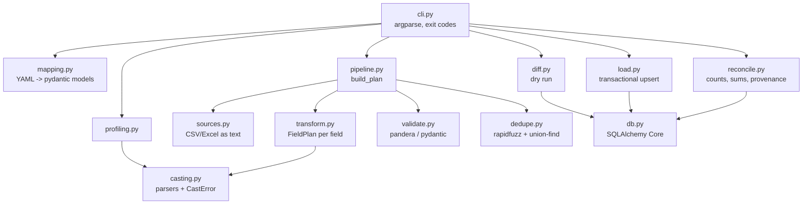
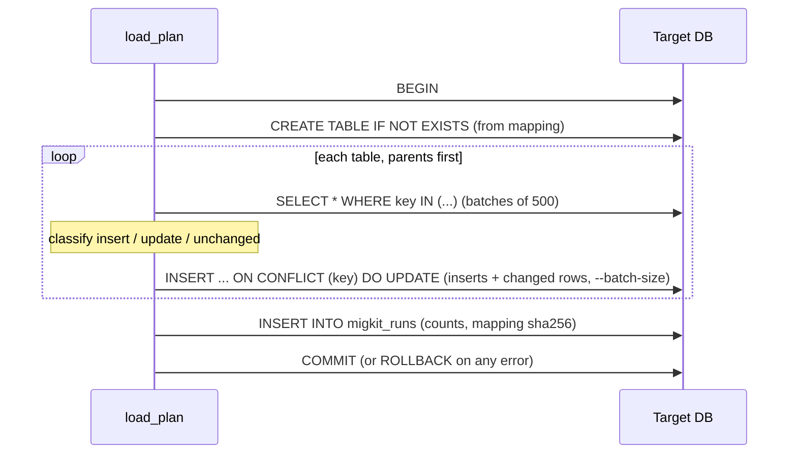

# Architecture

`migkit` is a single Python package with one job per module. Every command
starts by building the same offline `MigrationPlan`; only the last step of
`plan`, `load` and `reconcile` touches the target database.



## Modules

| Module | Responsibility |
|---|---|
| `mapping.py` | Parses the mapping YAML into strict pydantic models (`extra="forbid"`) and checks cross-references: sources and lookups exist, keys are fields, foreign keys point at the key of an earlier table, dedupe and row checks name real fields. Records the file's SHA-256. |
| `sources.py` | Reads CSV (encoding detection `utf-8-sig` -> `cp1252` -> `latin-1`, delimiter sniffing) and Excel sheets as strings. Checks the header row for duplicates before pandas can rename them. Adds `__source_row__`: the line a CSV record starts on (quoted fields may span lines; blank lines are skipped but still counted) or the worksheet row number in Excel, wherever the header sits. Loads lookup tables. |
| `casting.py` | All parsers: integers, decimals in US, European and Indian notation with currency symbols and accounting brackets, booleans, dates with a format list, phone numbers to E.164. Every failure is a `CastError` with a readable reason. |
| `profiling.py` | Per-column type inference (same parsers, 90% threshold), null and placeholder counts, uniqueness, value shapes (`(999) 999-9999`), date format mix and findings. Text, Markdown and JSON output. |
| `transform.py` | Compiles each field into a `FieldPlan` (extract -> trim and null placeholders -> transforms -> value map -> lookup -> default -> cast) and applies it per row, collecting every failure. Also repoints foreign keys at deduplicated parents and rejects orphans. |
| `validate.py` | Builds a pandera `DataFrameSchema` or a pydantic model from the field rules (`required`, `unique`, `pattern`, `allowed`, `min`, `max`, `max_length`), then applies cross-field `row_checks`. Both engines return the same `Reject` objects. |
| `dedupe.py` | Multi-pass blocking on `block_on` fields, weighted rapidfuzz similarity, union-find clustering, survivor selection (`most_complete`, `first`, `latest:<field>`) and optional filling of the survivor's empty fields from its duplicates. |
| `pipeline.py` | Runs the stages per target table in mapping order and returns a `MigrationPlan`: rows to load, rejects, merges, and the raw per-row values needed for sum reconciliation. |
| `db.py` | Derives SQLAlchemy tables from the mapping (types, primary keys, foreign keys) plus the `migkit_runs` log; batched key lookups; dialect-specific `INSERT ... ON CONFLICT DO UPDATE`. |
| `diff.py` | Compares planned rows with the target by key: inserts, updates (with per-column old/new values), unchanged, target-only. Tolerates driver representations (`Decimal('10.0')` vs `10.00`). |
| `load.py` | One transaction: create missing tables, diff, upsert only inserts and changed rows in batches, append to `migkit_runs`. |
| `reconcile.py` | Reads planned keys back from the target and checks counts, field values, sums (per group) and the mapping checksum of the last load. Renders text, Markdown and JSON. |

## Stage order and why

1. **transform** first, because nothing else can run on untyped text.
2. **reference** before validation, so an orphaned child is reported as
   "no customers row with key 'ACC-0999'" rather than a generic constraint error
   at load time, and so children of merged parents are repointed before
   uniqueness is checked.
3. **validate** after references, on typed values.
4. **dedupe** last, on rows that are otherwise loadable. Parents are planned
   before children (mapping order is enforced), so the parent's merge map is
   ready when the child table is transformed.

A rejected parent makes its children orphans, and they are rejected at the
reference stage with that reason. Fixing the parent and re-running brings both
back.

## Row accounting

Each table plan satisfies

```
source rows = rows to load + rejected rows + merged rows
```

and `TablePlan.balanced` checks it. A row is rejected at most once: the first
failing stage removes it from later stages, with every reason that stage found.

## Load and idempotency



Re-running a load with unchanged inputs sends no rows. SQLite runs with
`PRAGMA foreign_keys=ON` so it enforces the same references PostgreSQL does.

## Reconciliation

For each table the reconciler fetches the planned keys from the target and
compares every column with the plan. For each `reconcile_sum` field it
computes, per `reconcile_by` group:

```
expected = source total - rejected amount - merged-away amount
OK when expected == planned total == total read from the target
```

Values that cannot be parsed never enter the source total; they are counted as
"unparsed rows" (those rows are always rejected). When `merge_fields` copies a
duplicate's amount into its survivor's empty field, that amount was loaded, so
it is not counted as merged away (each `Merge` records the fields it filled).
Dedupe never moves money between `reconcile_by` groups: an amount is copied
only from a duplicate in the same group, and the group itself only onto a
survivor that has no amounts yet.

Finally the latest `migkit_runs` entry must carry the same mapping SHA-256 as
the file being reconciled, so a report can never silently describe data
produced by another version of the mapping.

## Extending

- New transform: add it to `transform._transform_fn` and document it in
  `docs/MAPPING.md`.
- New field type: a parser in `casting.py`, a column type in `db.column_type`
  and a Python type in `validate.PY_TYPES`.
- New database: it needs an `ON CONFLICT`-style upsert in
  `db.upsert_statement` and an entry in `SUPPORTED_DIALECTS`.
